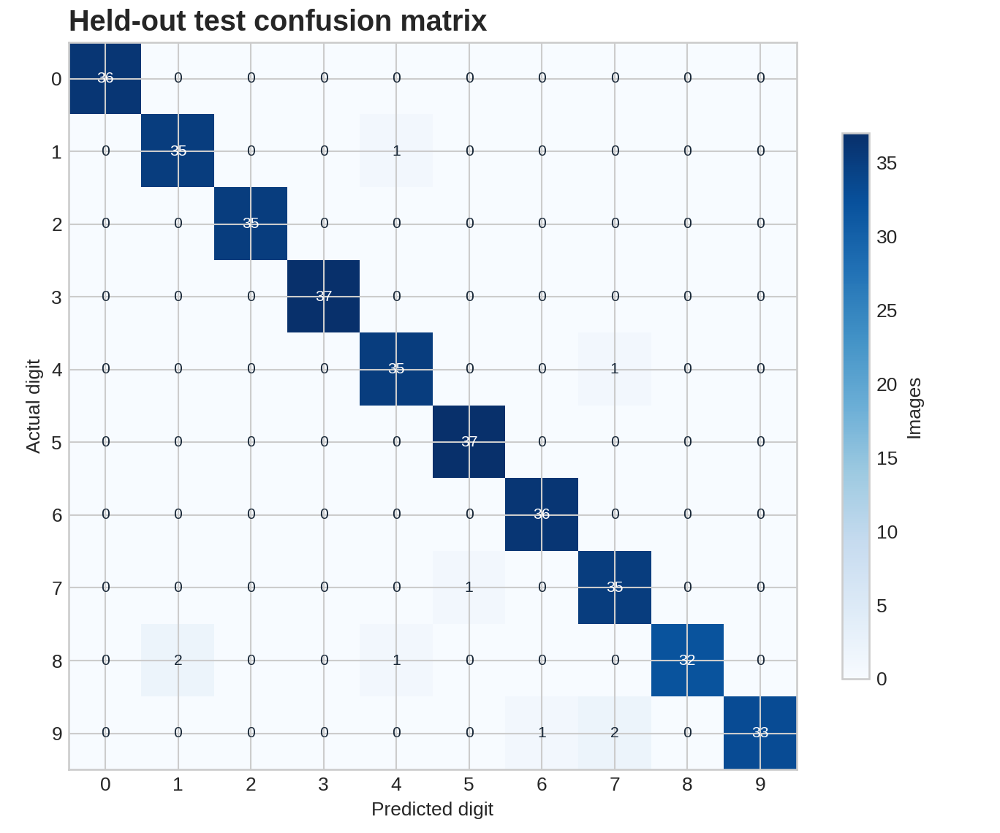
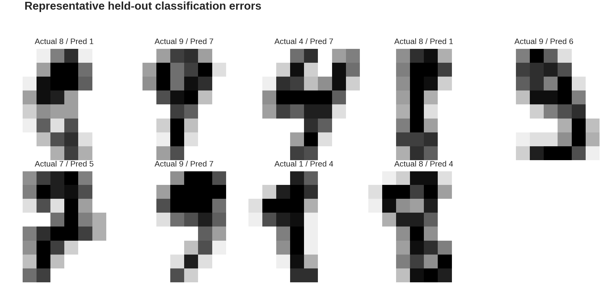

# Handwritten Digit Classification: Model Benchmark + Error Analysis

[Python](https://www.python.org/) · [Automated checks](https://github.com/zrose1211/handwritten-digit-classification/actions) · [Source files](https://github.com/zrose1211/handwritten-digit-classification/tree/main)

**Image classification with reproducible cross-validation, a sealed holdout, a usable inference script, and model-error inspection.**



## Project question

How accurately can a classical machine learning pipeline recognize handwritten digits (0–9) from low-resolution **8×8 images**? Does PCA help, and which digits get confused?

## Verified results

| Metric | Value |
|---|---:|
| Held-out accuracy | **97.50%** (351 correct of 360 test images) |
| Held-out macro F1 | **0.9748** |
| Selected model | StandardScaler + RBF-kernel SVM (C=1.0) |
| Cross-validation macro F1, development set | **0.9812** |

The classification model was **selected on the development set only**, using five-fold stratified cross-validation. The final test set was not included in model selection.

## Method

1. Load all **1,797** labeled digit images from `sklearn.datasets.load_digits`.
2. Reserve **360 samples (20%)** as a reproducible stratified holdout, untouched during selection.
3. Compare logistic regression, two RBF SVM settings, and a pipeline with 95%-variance PCA + SVM.
4. Standardize image features **inside the pipeline** so cross-validation does not leak test-fold statistics.
5. Select the highest development CV **macro F1**, retrain on all 1,437 development images, and evaluate the sealed test set once.
6. Export the confusion matrix, a gallery of misclassifications, per-class metrics, predictions and a serialized model.



## Compare the candidates

| Candidate | Mean 5-fold CV macro F1 |
|---|---:|
| Standardized RBF SVM, C=1 | **0.9812** |
| PCA (95% variance) + RBF SVM | 0.9798 |
| Standardized RBF SVM, C=10 | 0.9798 |
| Standardized logistic regression | 0.9679 |

The complete reproducible scoreboard, including fold variability, is in [`reports/metrics.json`](reports/metrics.json).

## Run it

```bash
python -m venv .venv
source .venv/bin/activate  # Windows: .venv\Scripts\activate
pip install -r requirements.txt
python -m pytest -q
python -m src.pipeline
```

`src/pipeline.py` recreates the model, figures, metrics, and predictions without an internet connection.

### Classify your own 8x8 sample

After training, save a NumPy array of **64 grayscale pixel intensities (0–16)**. Then run:

```bash
python -m src.infer path/to/your_64_pixels.npy
```

The file must contain a 1D array of exactly 64 numbers. This demonstration uses **the training dataset's native 0–16 grayscale scale**, not standard 0–255 image pixels. Only load the generated `.joblib` file from a trusted source; it relies on Python pickle serialization.

## Project files

```text
src/pipeline.py                   Dataset split, CV, model training, evaluation and plots
src/infer.py                      Checked command-line prediction function
tests/test_pipeline.py           Split determinism, CV and input validation
reports/metrics.json             Complete verified evaluation report
reports/test_predictions.csv     Held-out classifications with original row indices
reports/digit_classifier.joblib  Reproducible trained model artifact
reports/figures/                Confusion matrix and misclassification gallery
```

## Limitations and improvements

- This is a **small 8x8 benchmark**, not a deployed OCR application.
- Test images come from the same collection as training images; a new handwriting source could produce different results.
- Suggested next steps: benchmark against out-of-distribution images, add a small web demo, calculate performance across handwriting styles, and introduce a reject/abstention threshold.

## Dataset attribution

Scikit-learn's handwritten digits dataset: https://scikit-learn.org/stable/modules/generated/sklearn.datasets.load_digits.html

## Automated evaluation

The [Portfolio checks workflow](https://github.com/zrose1211/handwritten-digit-classification/actions/workflows/checks.yml) runs the test suite on GitHub Actions. Select **Run workflow** to regenerate the evaluation outputs; download the `evaluation-results` artifact from a successful run. The digits dataset is bundled with scikit-learn.
